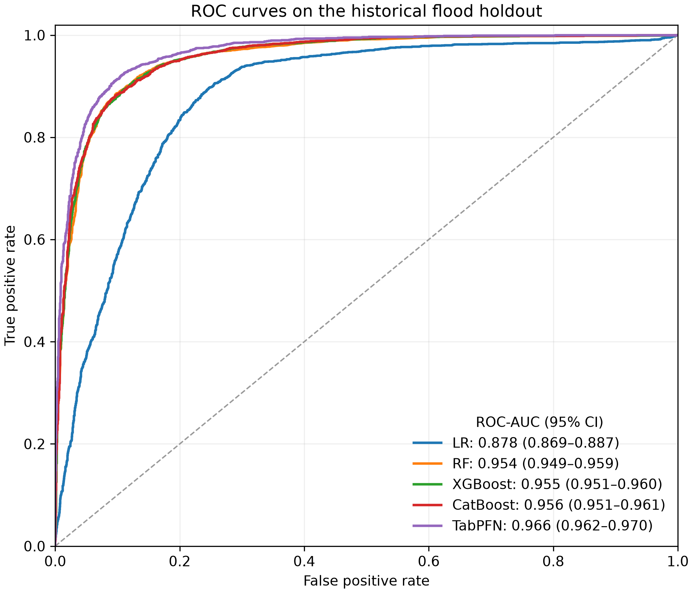
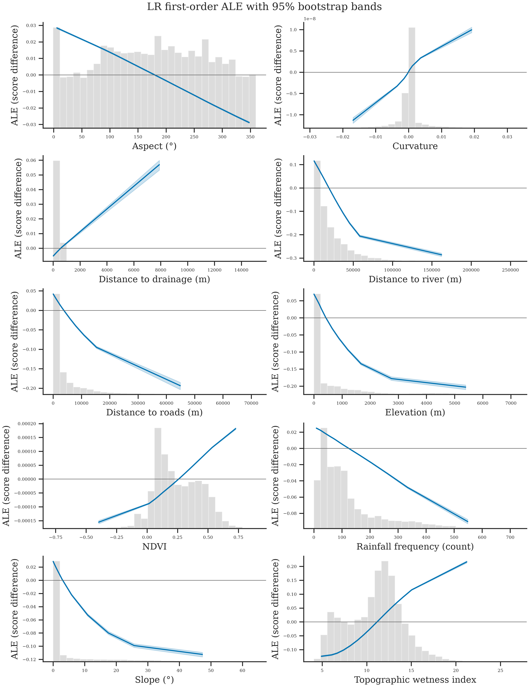
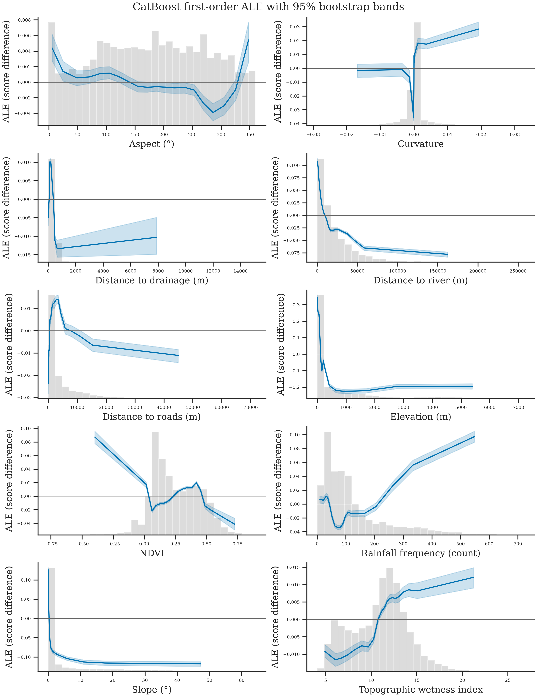

# Flood Susceptibility Mapping in Pakistan Using Machine Learning and ALE

This study compares five classifiers for assessing relative flood susceptibility in Pakistan from historical flood extents and ten environmental predictors. First-order accumulated local effects (ALE) show how fitted model scores vary with individual predictors over their observed ranges.

## Data sources

- **Flood inventory.** UNOSAT-derived extents for the 2010, 2014, and 2022 floods. The expanded 2022 inventory combines polygons labelled `Flood Water` from 14 UNOSAT-derived satellite products, including confirmed extents from September and October. [UNOSAT product archive](https://unosat.org/products)
- **Predictor rasters.** The ten supplied flood conditioning factors are attributed to Waleed & Sajjad (2025) and the accompanying Zenodo release. They share a nominal 30 m grid in EPSG:3395. The underlying data sources have different native resolutions. [Study](https://doi.org/10.1016/j.ijdrr.2025.105442) · [Predictor dataset](https://zenodo.org/records/20200726)

| Flood conditioning factors | Underlying source |
|---|---|
| Elevation, slope, aspect, curvature, and topographic wetness index | FABDEM terrain data |
| Distance to rivers and distance to drainage | HydroSHEDS-derived river and drainage data |
| Distance to roads | Global Roads Inventory Project (GRIP) |
| Normalized difference vegetation index (NDVI) | Landsat 8 imagery, 2021–2023 |
| Rainfall frequency | CHIRPS daily rainfall above 10 mm, 2010–2022 |

## Methodology

- **Inventory and sampling.** The main inventory is the union of the three mapped events. A pixel qualified as historical flood if it was mapped as flooded in at least one event. We sampled **10,000 flood pixels and 10,000 background pixels**. Background pixels fell outside the union and outside mapped OpenStreetMap water-layer polygons. The background label indicates absence from the mapped flood inventory. [OpenStreetMap contributor attribution](https://www.openstreetmap.org/copyright)
- **Preprocessing.** We aligned the inputs to the predictor grid, checked for duplicate sample pixels, and sampled only locations with valid values for all ten predictors. We decoded the supplied scaled rasters during extraction to recover their original units. The resulting dataset required no imputation. Pearson correlation and VIF were calculated on the full 20,000-point sample. All ten predictors were retained at a VIF cutoff of 5, with a maximum VIF of 3.012.
- **Models and validation.** A class-stratified **70/30 random split** gave **14,000 training and 6,000 test points**. Logistic regression (LR) served as the linear reference. Random Forest (RF) provided a bagged tree comparison, XGBoost and CatBoost represented two boosting approaches, and TabPFN provided a pretrained tabular comparison. For LR, RF, XGBoost, and CatBoost, grid search selected settings by mean ROC-AUC across **five stratified folds within the training set**. The search compared scaled and unscaled LR, and the selected LR used unscaled inputs. TabPFN used a fixed configuration and the same folds.
- **Holdout evaluation.** All five models were scored on the same 6,000 test points. ROC-AUC intervals used 2,000 class-stratified bootstrap replicates. Accuracy and class-wise metrics used a 0.5 classification threshold. Exact paired McNemar tests used Holm adjustment across the ten model pairs.

## Historical-union results

| Model | Test ROC-AUC (95% CI) | Accuracy | Flood precision / recall / F1 | Background precision / recall / F1 |
|---|---:|---:|---:|---:|
| Logistic Regression | 0.8781 (0.8691–0.8874) | 82.48% | 0.780 / 0.906 / 0.838 | 0.887 / 0.744 / 0.809 |
| Random Forest | 0.9543 (0.9494–0.9594) | 89.20% | 0.871 / 0.921 / 0.895 | 0.916 / 0.863 / 0.889 |
| XGBoost | 0.9554 (0.9506–0.9604) | 89.05% | 0.872 / 0.915 / 0.893 | 0.911 / 0.866 / 0.888 |
| CatBoost | 0.9562 (0.9514–0.9611) | 89.00% | 0.873 / 0.912 / 0.892 | 0.908 / 0.868 / 0.887 |
| TabPFN | 0.9658 (0.9617–0.9700) | 90.68% | 0.898 / 0.918 / 0.908 | 0.916 / 0.896 / 0.906 |

TabPFN achieved the highest ROC-AUC (**0.9658**) on the random holdout. Its row and the ROC figure both use the saved Windows predictions.

**Separate recurrent-flood experiment.** A separate run used locations mapped as flooded in at least two event years as positives and excluded once-flooded locations from both classes. CatBoost achieved a random-holdout ROC-AUC of 0.9929 under that sampling design. That result is reported separately because the positive class and test sample differ.

## Accumulated local effects

Completed first-order ALE analyses for LR, RF, XGBoost, and CatBoost used the training data, 20 requested intervals, 150 bootstrap replicates, and a 10,000-point subsample. The figures show LR and CatBoost.

- Both models generally assigned higher scores at lower elevations, on flatter terrain, and closer to rivers. CatBoost’s elevation and slope effects fell sharply near the low end of the observed ranges and then levelled off.
- The rainfall-frequency curves differed. LR scores fell as rainfall frequency increased, while CatBoost scores rose at the high end after a dip at lower frequencies. These patterns describe fitted model responses. They do not establish causal effects or physical thresholds.

## Limitations

- Training and test points share geographic areas. The random holdout and point-level uncertainty estimates do not establish performance in unseen regions.
- The rainfall-frequency layer overlaps the historical event period, so the evaluation is retrospective.
- Nationwide susceptibility maps and class-area summaries remain pending. The model scores represent relative susceptibility rather than annual flood probability.

ALE methodology was adapted from Tella et al. (2026), *Advancing Flood Susceptibility Mapping with Explainable AI: A Novel Application of Accumulated Local Effects (ALE)*. [Reference](https://doi.org/10.1007/s11269-025-04430-0)
